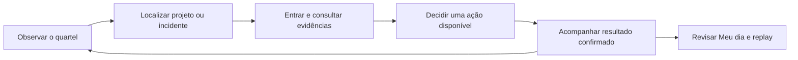
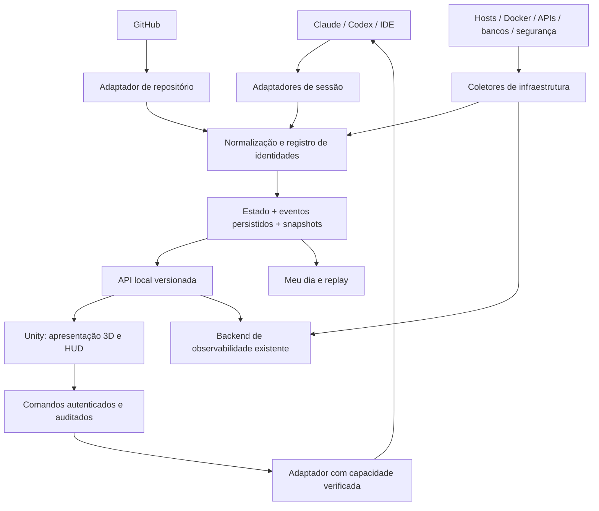

# War-Room3D — Concepção da Experiência e Projeto Técnico

Versão: 1.0 · Data: 06/11/2026 · Complemento do [PRD](PRD.md).

**Estado:** documento aprovado em 06/11/2026 como referência de planejamento. “GDD” descreve aqui a experiência espacial e lúdica de um produto de operação, além de sua arquitetura técnica. O quartel não transforma tarefas reais em objetivos fictícios de jogo. Tecnologias e orçamentos propostos não significam instalação, integração ou desempenho já validados.

## 1. Conceito, pilares e experiência

Um escritório de desenvolvimento torna-se um centro de operações sci-fi. Projetos ocupam salas; agentes têm presença, estações e relações visíveis; infraestrutura compartilhada ocupa o núcleo. O usuário observa, identifica uma situação, aproxima-se, consulta evidência, decide quando necessário e acompanha o resultado.

Pilares: **trabalho observável**, **continuidade espacial**, **clareza operacional**, **vida ambiental discreta** e **controle explícito**. O usuário deve entender a cena sem confundir decoração com evidência.



Não há vitória, derrota, XP ou pontuação por tokens no núcleo do produto. O retorno positivo vem de marcos reais, legibilidade do progresso e celebrações breves. Uma falha gera informação e prioridade, não punição ao usuário ou ao avatar.

## 2. Referências e o que aproveitar

| Referência | Aproveitar | Evitar |
|---|---|---|
| Habblaud | Salas por sessões, ocupação, saída/luzes, cotidiano, GitHub, Meu dia e timelapse | Copiar pixel art, presumir controle uniforme de provedores ou incluir cidade online no MVP |
| War room anterior | Agentes ao redor de mesa, foco de projeto, feed e painéis operacionais | Roteamento de evento sem projeto/sessão e excesso de texto dentro da cena |
| Conceito de seis salas | Arquitetura conectada, núcleo e identificação de projetos | Planta exclusivamente 2D e salas fixas como limite do produto |
| Conceito sci-fi | Grafite, iluminação ciano contida e vidro | Neon excessivo, vermelho decorativo e paredes altas que ocultam o trabalho |
| GLB v2 | Composição do núcleo/data center, racks, corredores e salas periféricas | Tratar figuras estáticas e telas texturizadas como agentes e informação reais |

As imagens recebidas e a prancha anterior são referências de composição. As quatro imagens da avaliação v2 são renders do modelo real em iluminação de inspeção. Nenhuma delas prova a aparência final de materiais no Unity.

## 3. Organização do mundo

### 3.1 Setores e salas

Cada setor oferece seis posições de sala ligadas por corredores a um núcleo de circulação/operação. A disposição final prioriza visibilidade e tratamento de oclusão, não fica presa às duas fileiras da primeira prévia. Um projeto ocupa uma posição persistente. Setores adicionais aparecem conforme necessário; trocar setor não replica logicamente o data center ou duplica seus incidentes.

Se o núcleo for representado em vários setores, são acessos ao mesmo estado operacional com filtro contextual. Projetos sem sessões continuam registrados. Sala inativa pode ser recolhida pelo usuário; a busca e os alertas permanecem acessíveis. O sistema não troca todas as salas de lugar quando uma sessão encerra.

Espaços ainda não usados são encaixes arquitetônicos discretos, sem nomes de projetos fictícios. O cenário de demonstração pode preencher seis salas, mas usa domínio de dados próprio e selo persistente.

### 3.2 Sala do projeto

Componentes: piso, paredes recortáveis, entrada, iluminação por zona, mesa central, holograma, estações, painéis e posições de agentes. A mesa representa o contexto do projeto; os agentes em execução ficam em estações ou posições coerentes ao redor dela. Não exigir deslocamento físico para acessar detalhes.

Vários agentes principais podem coexistir. A hierarquia é mostrada pela lista lateral e por conexões discretas sob seleção, não pela posição arbitrária de um avatar “chefe”. Um agente sem função declarada recebe “Função não informada”, ou um apelido local claramente identificado.

Sessões numerosas usam agrupamento visual: até 12 avatares individuais por sala na configuração inicial proposta; excedentes aparecem como grupo com contagem e lista completa. Selecionar um agente agrupado destaca uma posição de foco. O agrupamento nunca reduz a contagem real exibida.

### 3.3 Data center

O centro permanente possui mesa de topologia, painéis em arco segmentados, racks e estações. Categorias: rede, bancos, servidores, APIs, Docker, logs e segurança. A cena resume; um painel contextual oferece números e evidências legíveis.

Racks representam agrupamentos lógicos por ambiente ou conjunto de recursos. Somente uma fonte de inventário confiável permite dizer que correspondem a hardware físico. Um projeto selecionado filtra seus recursos; selecionar recurso compartilhado revela todos os projetos dependentes. Conexões luminosas aparecem sob seleção, não permanentemente no quartel inteiro.

O globo pode ser substituído por um grafo de dependências. Não desenhar ataques vindos de países nem localizar tráfego no planeta sem evidência geográfica e sem identificar sua incerteza.

### 3.4 Áreas sociais

Pequena área de descanso e percursos ociosos são evolução visual opcional. O agente não decide tomar café; a animação representa ociosidade. Balões de conversa decorativos não devem inventar mensagens atribuídas ao modelo. A cidade, outros usuários, visitas e economia são outro produto/escopo.

## 4. Telas e navegação

| Vista | Cena dominante | UI essencial | Saídas |
|---|---|---|---|
| Quartel-general | Setor com salas e núcleo | Busca, etiquetas, resumo selecionado, saúde das fontes, Meu dia/Timelapse | Entrar na sala, abrir data center, trocar setor |
| Interior do projeto | Mesma sala aproximada | Breadcrumb, sessões/árvores, tarefa, ferramentas/skills, eventos e infraestrutura | Voltar ao quartel, selecionar recurso, focar agente |
| Outro ângulo | Mesma cena, mesmo estado | Ângulo/zoom/restaurar; mesma seleção | Retomar enquadramento anterior |
| Data center | Núcleo, topologia e racks | Projeto/ambiente, recurso, saúde, atualidade, incidentes e evidências | Ir à sala, abrir detalhe de log/indicador |
| Meu dia | Ambiente atenuado ou painel de leitura | Data/fuso, filtros, métricas, cobertura, marcos e incidentes | Abrir evidência ou replay do período |
| Timelapse | Cena histórica reconstruída | Selo REPLAY, data/hora, velocidade, pausa, busca, lacunas | Voltar ao vivo com ressincronização |
| Configuração/diagnóstico | Painel de leitura | Fontes, escopos, versões, capacidades, retenção e falhas | Testar conexão, habilitar/desabilitar fonte, exportar diagnóstico |

Mostrar somente o painel contextual necessário. Feed e árvore são recolhíveis; abrir um incidente não deve ocultar seu ambiente ou a indicação de replay. Mensagens e permissões usam um painel de ação próprio, sem transformar um clique no avatar em comando.

## 5. Câmera e entrada

Visão inicial isométrica elevada; interiores com perspectiva moderada. Uma única identidade de sala preserva posição de mobiliário, agentes e dados entre as vistas. Trocas de câmera não recriam o estado de negócio.

| Entrada proposta | Ação |
|---|---|
| Clique esquerdo | Selecionar sala, agente ou recurso |
| Botão “Entrar na sala” / Enter com sala focada | Aproximar o interior |
| Arrastar com botão direito sobre cena | Orbitar horizontalmente e ajustar inclinação limitada |
| Roda sobre cena / botões + e − | Aproximar/afastar |
| Botão central arrastado | Deslocar foco dentro de limites da vista |
| Home / “Restaurar câmera” | Restaurar enquadramento da vista atual |
| Esc / “Voltar ao quartel” | Fechar detalhe primeiro; depois retornar à vista anterior |
| Ctrl+F / busca visível | Buscar projeto/agente/recurso |
| Tab, Shift+Tab e Enter | Navegar e ativar controles de UI |

Atalhos não disparam enquanto um campo de texto está capturando a entrada. Órbita horizontal de 360°; limites iniciais de inclinação de 25° a 70°, ajustáveis por vista no ensaio de arte. Zoom usa limites derivados do tamanho da sala e não atravessa piso/mesa. Transição sugerida de 0,4–0,8 s, substituível por corte quando “Reduzir movimento” estiver ativo.

Paredes e painel curvo que ocluem o alvo usam ocultação/transparência por módulo. Renderização não altera colisores ou dados. O botão restaurar recupera também peças temporariamente ocultadas. O teste deve cobrir quatro lados, interior, saída, retorno e troca de setor; um único screenshot não valida a câmera.

No MVP, o usuário controla câmera e seleção. Passear com um avatar humano fica posterior, sem se tornar obrigatório para navegar ou resolver solicitações.

## 6. Direção de arte e interface

Dark mode com arquitetura sci-fi sóbria: grafite, metais com variação controlada, vidro fumê, telas ciano e verde. Sem pixel art, corpos voxel ou neon cobrindo todas as arestas. Teto removido e paredes preparadas para corte; profundidade deve continuar evidente.

| Elemento | Referência inicial | Regra |
|---|---|---|
| Fundo | `#080E14` | Profundo, sem apagar contornos relevantes |
| Painéis HUD | `#101A24` | Opacidade suficiente para leitura independente da luz 3D |
| Texto principal | `#EDF5FA` | Corpo inicial 14–16 px lógicos; títulos 18–24 |
| Texto secundário | `#94A9B8` | Não usar para informação crítica com baixo contraste |
| Seleção/navegação | `#75E4EE` | Ciano; não significa automaticamente saúde |
| Saúde confirmada | `#8FE2B1` | Verde acompanhado de texto/ícone |
| Atenção/degradação | `#EABA6D` | Âmbar para espera de decisão e condições degradadas identificadas |
| Falha/incidente | `#F06A6A` | Vermelho reservado a estados operacionais relevantes |
| Sem dados | Cinza com ícone e horário | Nunca reutilizar verde antigo sem indicar desatualização |

Referência desktop 1920×1080; validar 1440×900 e escalas 100/125/150%. Rótulos compactos podem usar 12 px apenas para informação secundária; detalhes essenciais vão para painel legível. Etiquetas projetadas devem resolver sobreposição por prioridade, seleção e agrupamento, não por diminuir indefinidamente a fonte.

Todos os textos da interface em português. Nomes próprios de ferramentas, provedores, projetos e identificadores técnicos podem ser preservados. Exemplos: “Trabalhando”, “Aguardando decisão”, “Sem dados recentes”, “Último evento aplicado”, “Origem não informada”. Não exibir termos de implementação como nomes de tabelas ou tipos internos em fluxos comuns.

## 7. Agentes, animação e comportamento ambiental

Avatares 3D estilizados e consistentes, com variação moderada de aparência, nome e distintivo do provedor. Aparência persiste pelo identificador do agente/sessão, não pelo nome textual. Trocar cor de alerta não altera identidade. Não associar capacidade técnica a características pessoais do personagem.

| Estado observado | Representação | Limite semântico |
|---|---|---|
| Sessão detectada | Chegada discreta e ocupação de estação | Não implica que já esteja executando tarefa |
| Trabalhando | Digitação/análise diante da estação | Ferramenta concreta aparece no detalhe, não é inferida da animação |
| Aguardando instrução | Postura neutra, indicador textual | Diferente de pedido de permissão |
| Aguardando decisão | Marcador âmbar e painel de solicitação | Só quando há pedido real vigente |
| Ocioso | Pequenos deslocamentos/descanso | Simulação não gera conversa real ou tarefas |
| Presença incerta | Avatar atenuado com “Sem confirmação” | Não animar saída como encerramento confirmado |
| Encerrado | Saída curta, liberação de estação | Não significa que a tarefa terminou com sucesso |
| Falha operacional | Marcador sobre o alvo e acesso à evidência | Não tratar avatar como culpado pela falha do recurso |

Movimento usa trajetos e posições válidas do módulo. Chegada visual não deve atrasar a atualização do painel. Se a animação falhar ou houver muitos agentes, posicionar diretamente e manter estado legível. Não colocar todos os avatares em cima da mesa para acomodar excesso.

Conexões pai/filho são desenhadas apenas sob seleção. Uma conversa entre modelos só aparece como comunicação se existir evento explícito com participantes e evidência; caso contrário, balões decorativos ficam sem conteúdo atribuído e fora do feed.

## 8. Luzes, efeitos e áudio

Cada sala tem zonas separadas: luz ambiente, estações, identificação e alerta. Ao encerrar a última sessão, apagar estações/atividade; manter circulação e sinalização de incidente. O data center não depende da presença dos agentes.

| Gatilho | Efeito proposto | Duração / persistência |
|---|---|---|
| PR mergeado confirmado | Celebração discreta na sala, partícula/confete tecnológico | 8 s; marco persiste no histórico |
| Release confirmada | Sinal comemorativo distinto | Breve; sem confundir com saúde de produção |
| CI falhou | Giroflex e destaque do projeto | Movimento breve; ícone persiste até resolução correspondente |
| Pedido de decisão | Pulso âmbar no agente | Até resolver/expirar; reduzível para ícone estático |
| Recurso indisponível | Destaque do recurso e projetos dependentes | Enquanto incidente/impacto estiver ativo |
| Coletor desconectado | Atenuação/ícone de sem dados | Até coleta válida retornar |

Animações têm prioridade: pedido/alarme não é encoberto por festa. Agrupar rajadas de eventos para evitar dezenas de efeitos concorrentes; manter todos os marcos relevantes no histórico. Carregamento inicial e ressincronização não reproduzem festas antigas ao vivo.

Áudio desligado por padrão. Opções separadas para ambiente, celebrações e alertas; volume, silenciar e reduzir movimento acessíveis. Nenhum estado crítico depende apenas de cor, som ou piscar. Não tocar alarme indefinidamente como mecanismo de prioridade.

## 9. Aproveitamento dos GLBs e produção de arte

| Dado inspecionado | v1 | v2 |
|---|---:|---:|
| Tamanho | 62.676.700 bytes | 62.645.756 bytes |
| Vértices | 998.596 | 1.005.908 |
| Triângulos | 1.873.840 | 1.886.287 |
| Nós / malhas / materiais | 1 / 1 / 1 | 1 / 1 / 1 |
| Animações / skins | 0 / 0 | 0 / 0 |

A v2 tem três texturas 4096×4096, quatro salas periféricas e núcleo. O ciano aparente está na textura; não há material emissivo configurado nem luzes no arquivo. Os textos não são editáveis como UI. A conectividade revelou 1.200 componentes, sem identificação semântica; não há promessa de separação automática por sala.

Estratégia aprovada de direção: híbrida. Preservar originais, usar o modelo para proporções/composição, recuperar peças que mantenham qualidade e reconstruir partes funcionais. O primeiro ensaio compara uma sala, um rack e um trecho do painel. Se extrair exigir correção maior que remodelar, reconstruir o módulo e manter a referência visual.

O fluxo de autoria pode usar Tripo3D para candidatos gerados por peça, Blender para tratamento e Unity para prova de cena/build. A identidade e a função de “Canvas” ainda precisam ser confirmadas. Essas ferramentas MCP/CLI auxiliam a produção; não integram o runtime nem substituem os adaptadores de sessões. Procedimento, prompt e evidências em [PIPELINE-ARTE-MCP](docs/PIPELINE-ARTE-MCP.md).

### 9.1 Kit modular proposto

| Ativo | Separações necessárias |
|---|---|
| Sala | Piso, segmentos de parede, porta, molduras, pontos de corredor e âncoras |
| Mesa | Base, superfície, projetor e holograma independente |
| Estação | Mesa, cadeira, tela funcional e posição de avatar |
| Núcleo | Piso, arco segmentado, estações, mesa de topologia e acessos |
| Rack | Carcaça, indicadores e volume de seleção; sem servidor lógico inventado |
| Avatar | Malha, rig, animações e acessórios separados |
| Sinalização | Nome/estado em UI, nunca texto operacional pintado na textura |

Escala de ensaio: 1 unidade Unity = 1 metro; sala de referência aproximadamente 8×8 m, núcleo com cerca de 16 m de diâmetro útil e corredores de 3 m. São proporções para prototipação, não medidas extraídas do GLB nem norma de arquitetura. Ajustar para leitura dos avatares e câmera antes de congelar encaixes.

Pivôs no piso/encaixe, nomes estáveis, orientação consistente, UVs preservadas e materiais separados para superfícies, vidro, telas e emissão. Colisores simples; não converter automaticamente 1,89 milhão de triângulos em colisão. Pontos de interação e percurso ficam fora da malha decorativa.

### 9.2 Orçamentos iniciais de arte

Alvo de ensaio, não limite universal: até aproximadamente 1 milhão de triângulos visíveis no setor de referência; avatares próximos de 5–15 mil triângulos no LOD principal e versões reduzidas à distância; texturas 1K/2K para peças comuns e 4K apenas quando a inspeção justificar. As decisões finais seguem frame time/memória e comparação visual.

A v2 intacta excede esse alvo geométrico proposto; pode servir ao protótipo de inspeção, mas não será multiplicada por projeto. Não aplicar redução cega que destrua portas, silhueta, UV ou painéis. Manter uma captura de referência para cada revisão de arte.

Aceite de ativo: aparência legível em quatro ângulos e aproximação, sem figuras residuais estáticas confundindo agentes, sem texto fictício, sem oclusão não tratada, materiais corretos no build, limites de seleção previsíveis e origem/licença registrada.

## 10. Arquitetura do produto



O diagrama representa fronteiras lógicas, não exige um processo para cada caixa. Inicialmente, um serviço local contém os módulos de domínio e adaptadores. Coletores remotos/observabilidade podem ser processos externos. Unity consome estado normalizado e emite intenções; não interpreta JSONL de provedores nem acessa credenciais administrativas.

### 10.1 Alternativas e decisão

| Opção | Benefício | Custo / decisão |
|---|---|---|
| Unity + adaptador de serviço de sessões existente | Primeira prova com sessões reais mais rápida | Dependência de versão/semântica; apenas transição de integração |
| Unity + serviço Node próprio, reaproveitando módulos adequados | Contrato controlado e preservação do conhecimento dos parsers | Caminho de produto; manter atribuição, testes e compatibilidade |
| Tudo em C# | Um runtime principal | Refaz parsing, histórico e diferenças de provedores; não escolhido para a primeira entrega |

O adaptador temporário não deve se tornar contrato implícito de toda a UI. O core do produto define suas identidades, capacidades e eventos. Se a fonte não estiver disponível, exibir isso; não iniciar demonstração automaticamente como se fosse dados reais.

Fontes podem oferecer transportes distintos, como Socket.IO e HTTP/SSE. Não são intercambiáveis; cada adaptador entrega o mesmo contrato interno. Não conectar WebSocket puro a Socket.IO esperando equivalência.

## 11. Tecnologias escolhidas e política de versão

Consulta documental em 06/11/2026; referências primárias na seção 21. Escolhas abaixo são a base proposta para os ensaios. Versões exatas de pacotes devem ser fixadas nos manifests/lockfiles ao criar cada componente; não usar “latest” como contrato de distribuição.

| Camada | Tecnologia / baseline | Motivo e validação |
|---|---|---|
| Cliente desktop | Unity 6.3 LTS, referência local 6000.3.27f1; C# | Versão instalada e linha LTS; validar patch antes de congelar o projeto |
| Renderização | URP compatível com o Editor escolhido | Materiais/iluminação ajustáveis para desktop; HDRP não é requisito |
| HUD e listas | UI Toolkit, UXML/USS | Painéis de dados, busca e listas; validar foco, escala e input na versão 6.3 |
| Superfícies 3D | uGUI/TextMeshPro ou textura renderizada, limitada aos painéis do mundo | Separar leitura detalhada no HUD de aparência holográfica; validar interação mista |
| Entrada | Unity Input System | Mapas de ação para câmera/UI, sem conflito com campos e scroll de listas |
| Animação | Animator, prefabs e trajetos/âncoras; navegação adicional somente se necessária | Estados visuais separados do domínio; chegada não bloqueia atualização |
| Importação | Unity glTFast para GLB no Editor | Ensaiar materiais/avisos e variantes de shader no build; não é gerador de módulos |
| Produção de arte | Blender, GLB preservado e derivados versionados | Limpeza, separação, remodelagem, UV, LOD e renders de referência |
| Assistência de autoria | MCP/CLI de Unity, Blender e Tripo3D; Canvas a identificar | Acelerar ensaio de ativos e cena com revisão humana; nenhum deles é conector operacional do aplicativo |
| Serviço local | Node.js 24 LTS + TypeScript estrito | Reuso de parsing/ecossistema; 24 é escolha conservadora, não alegação de versão mais recente |
| API do produto | HTTP/JSON para consulta/comandos + SSE para estado/eventos | Uma via de eventos e comandos correlacionados por HTTP; reconexão explicitamente contratada |
| Contratos | JSON Schema versionado e modelos C#/TS verificados por fixtures comuns | Evitar divergência entre clientes e coletores |
| Persistência | SQLite local, WAL e escritor único no serviço | Eventos/metadados/snapshots; não usar pasta de rede ou sincronizada como banco ativo |
| Observabilidade | Adaptadores para fontes existentes; OpenTelemetry Collector/OTLP quando aplicável | Coletar/normalizar sinais; Collector não substitui armazenamento/consulta |
| Credenciais | Armazenamento protegido do sistema operacional e referências opacas | Nada em GLBs, documentos, logs ou configuração versionada |
| Validação | Unity Test Framework; testes TS com Vitest; fixtures de protocolo | Domínio, reconexão, adaptadores e regressão visual por cenário |
| Distribuição | Build Windows x64 + serviço local empacotado e supervisionado | Instalador, atualização e assinatura definidos no plano de distribuição, sem Docker obrigatório ao usuário |

A consulta genérica de UI retornou também documentação de Unity 6.6. As capacidades dessa versão não serão presumidas na 6.3. A escolha UI Toolkit para HUD e superfícies 3D separadas é deliberada; a prova técnica deve verificar roteamento de foco e teclado. Não é necessário introduzir React, Electron, Nest, Kubernetes ou Redis para o núcleo local.

Node 24, 26 e 22 aparecem como LTS na consulta da data. O projeto propõe 24 por estabilidade de compatibilidade com a referência; migrar de major requer suíte de adaptadores e teste de empacotamento. O driver SQLite e sua versão embarcada serão escolhidos no ensaio de persistência, verificando correções de WAL e compatibilidade Windows; o contrato de persistência independe do driver.

## 12. Componentes e responsabilidade

| Componente lógico | Responsabilidade | Não faz |
|---|---|---|
| SourceAdapter | Ler fonte e produzir fatos/capacidades/saúde com versão | Decidir posição de avatar |
| ProjectRegistry | IDs, caminhos canônicos, aliases, worktrees e vínculos | Agrupar só por nome de pasta |
| SessionRegistry | Presença e relações de sessão/agente | Inventar hierarquia por proximidade |
| EventNormalizer | Validar envelope, contexto e proveniência | Tratar texto externo como comando |
| StateReducer | Aplicar transições determinísticas e correções | Disparar efeitos de render diretamente |
| EventStore | Persistência, cursores, snapshots e retenção | Guardar todo log bruto sem política |
| ResourceGraph | Recursos, ambientes e dependências | Inferir causalidade só por coincidência temporal |
| IncidentEngine | Regras versionadas, correlação, reconhecimento e resolução | Confundir animação encerrada com recuperação |
| CommandGateway | Autenticar, revalidar capacidade, prazo, alvo e auditoria | Aceitar shell arbitrário do cliente |
| HistoryService | Agregações Meu dia e consultas de replay | Gerar produtividade humana fictícia |
| Unity StateClient | Sincronizar e expor modelos de leitura | Ler credenciais/transcripts diretamente |
| Room/Agent/ResourcePresenter | Transformar estado em cena e sinalização | Alterar a verdade operacional |
| CameraController / HudPresenter | Navegação, foco, legibilidade e seleção | Reordenar histórico ou executar tarefas |
| EffectDirector | Animações priorizadas e reproduzíveis | Criar incidentes ou mensagens reais |

Cada componente deve ser testável com entradas pequenas. O adaptador da referência pode ser substituído sem reescrever a cena. O renderer pode mudar sem alterar a interpretação de uma permissão ou incidente.

## 13. Modelo de dados e contrato

### 13.1 Entidades

| Entidade | Identidade / campos essenciais |
|---|---|
| Project | projectId estável, nome, caminhos/aliases, worktree policy, archivedAt |
| RoomPlacement | projectId, sectorId, slotId, versão de layout, preferências visuais |
| Session | sessionKey interna, provider, accountRef opaco, providerSessionId, projectId, source/origin, presença, lastSeen |
| Agent | agentKey, sessionKey, providerAgentId, parentAgentKey opcional, função/nome declarados, estado observado |
| Task | taskId, contexto, título redigido, estado declarado/confirmado e evidências |
| ToolInvocation / SkillInvocation | invocationId, agente, nome, início/fim quando conhecidos, resultado/erro e referência |
| Environment | environmentId, nome, classe desenvolvimento/homologação/produção/outro |
| Resource | resourceId, tipo, ambiente, connectorId, saúde, frescor, propriedades permitidas |
| ProjectResource / Dependency | vínculos muitos-para-muitos, direção, escopo, origem e confiança |
| Incident | incidentId, regra/fonte, recurso/ambiente, projetos impactados, estado, severidade, evidências e transições |
| GitHubEntity / CIRun | repoId, entidade, ref, SHA, workflow, runId, tentativa, conclusão |
| Command / Permission | commandId/requestId, alvo, capacidade, prazo, estado, autoria local e resultado |
| SourceHealth | sourceId, tipo, versão, conectividade, lastReceived, lastApplied, cobertura e erros |

Não fundir IDs externos de contas distintas. Um `cwd` é pista para projeto, não identidade completa. Guardar o caminho original e a resolução adotada; aliases Windows/WSL são explícitos. Mover um projeto exige atualizar vínculo sem reescrever fatos antigos.

### 13.2 Envelope de evento proposto

| Campo | Regra |
|---|---|
| schemaVersion | Versão major/minor do contrato |
| eventId | ID interno único e estável após persistência |
| sourceId / sourceEventId | Origem e ID externo quando existir; chave de deduplicação derivada quando não existir |
| sourceVersion / sourceSequence | Parser/protocolo e sequência da fonte quando disponível |
| streamSequence | Sequência global de ingestão atribuída pelo serviço; não confundir com ordem temporal real |
| occurredAt / observedAt / receivedAt | Instante de origem opcional, observação e recebimento UTC; origem ausente não é fabricada |
| projectId / sessionKey / agentKey | Contexto condicional por tipo; evento de infraestrutura pode ter vários projetos via vínculos |
| resourceId / environmentId | Obrigatórios para transições de recursos que os exijam |
| type / payload | Tipo conhecido e conteúdo validado por schema |
| provenance | `observed`, `inferred`, `user_asserted` ou `illustrative`; regra/versão quando inferido |
| correlationId / causationId | Relações explícitas; coincidência temporal não preenche causationId |
| evidenceRefs | Referências autorizáveis, redigidas, com cobertura/expiração |
| ingestionMode | `live`, `backfill`, `resync` ou `demo`; evita efeitos ao vivo por carga histórica |

Famílias: workspace, session, agent, task, tool, skill, source, resource, incident, github, command e visualEffect. Eventos de infraestrutura não precisam inventar sessão/agente. Efeitos apontam ao evento que os originou. Evento sem contexto obrigatório fica em diagnóstico/quarentena redigida, sem alterar sala arbitrária.

### 13.3 Aplicação, duplicação e ordem

Persistir evento aceito, chave de deduplicação, atualização de estado e cursor da fonte em transação consistente. Publicar após commit. Um evento recebido duas vezes não soma métricas, cria avatar ou celebra duas vezes. Usar ID da fonte; na ausência, derivar de fonte/arquivo/geração/offset/identidade do registro, tratando truncamento e rotação.

Ordem de ingestão não corrige relógio da fonte. Eventos atrasados podem corrigir histórico sem sobrescrever estado mais recente indevidamente. Cada adaptador define precedência/versão por entidade e expõe lacunas. Reinício revalida presença; não reapresenta todas as sessões antigas como vivas.

Tipos desconhecidos não quebram o cliente: guardar diagnóstico compatível e solicitar atualização quando necessário. Versão major incompatível bloqueia operações, informa motivo e evita aplicar payload por tentativa. Payloads externos nunca viram instruções executáveis.

### 13.4 API e sincronização propostas

Rotas conceituais versionadas: `/v1/health`, `/v1/capabilities`, `/v1/snapshot`, `/v1/events`, `/v1/projects`, `/v1/resources`, `/v1/incidents`, `/v1/history/day`, `/v1/history/replay` e `/v1/commands`. O plano técnico definirá schemas completos de request/response; estes nomes não descrevem endpoints já existentes.

Snapshot contém revision/streamSequence, estado e capacidades numa visão consistente. O cliente aplica deltas posteriores à revisão. SSE suporta retomada por cursor enquanto retido; cursor expirado/salto exige novo snapshot. Heartbeat é liveness de transporte, não evidência de atividade do agente. Não usar apenas “socket conectado” como estado de todas as fontes.

Cadências propostas: publicar mudanças agrupadas até 200 ms; heartbeat de transporte a cada 15 s; sem heartbeat por 45 s, marcar transporte perdido. Reconexão com backoff limitado e variação; comandos não são reenviados junto. Limite inicial de fila por cliente 8 MB: cliente lento é desconectado com diagnóstico e ressincroniza.

Na Unity, recepção/decodificação não bloqueia o frame. Mudanças da cena são aplicadas no thread principal, em lotes limitados. Leituras extensas de logs/histórico são paginadas. Limites e compatibilidade SSE/HTTP da biblioteca escolhida devem ser validados no build Windows, não só no Editor.

## 14. Fontes e adaptadores de sessão

### 14.1 Claude Code

O adaptador deverá combinar sinais autorizados de sessão, processo, eventos e arquivos quando disponíveis. A fonte e a versão de cada sinal precisam ser registradas. Subagentes exigem vínculo explícito; conteúdo herdado não gera atividade nova por si só. Uso de tokens não é mecanismo de presença.

Mensagens e permissões são capacidades separadas da observação. Sua existência e semântica serão validadas por provedor antes da implementação de M4. Cotas/custos só existem quando a origem disponibiliza informação compatível.

### 14.2 Codex

O adaptador Codex precisa distinguir sessão, diretório de projeto e primeira atividade. Uma sessão sem contexto de projeto suficiente fica em diagnóstico até ser resolvida. Heurísticas de tempo são inferências, não prova universal de encerramento.

O suporte a mensagens e aprovações depende da interface e da versão escolhidas no Windows; M1 observa, M4 valida comandos. Não afirmar suporte ao App Server nem atribuir origem VS Code apenas pelo provedor sem prova específica.

### 14.3 VS Code

Integração opcional publica abertura/fechamento de workspace e contexto quando suportado. Workspace é presença de projeto, não tarefa executada. O plugin não precisa ser intermediário obrigatório para sessões CLI. Identificar origem como `vscode`, `cli`, `desktop` ou `unknown` somente com evidência adequada.

### 14.4 Reconciliação e falhas

Watchers são sinais auxiliares; leitura incremental, checkpoints e reconciliação periódica compensam eventos perdidos, arquivo rotacionado e linhas incompletas. Cadência inicial local proposta: 1 s para reconciliação de sessões, com backoff para fontes indisponíveis e custo medido. Não fazer varredura ilimitada de todo o disco.

Hooks podem perder eventos. O contrato distingue recebido, aplicado e ignorado. Retry e reconciliação são implementados por adaptador conforme a capacidade da fonte. Os alertas operacionais sobre perda de cobertura são parte da UI.

### 14.5 Limites de licença e ativos

Qualquer código reaproveitado exige conferência da licença aplicável, atribuição/aviso e testes pertinentes. Arte, modelos e recursos externos precisam de inventário de origem e permissão de distribuição; licença de código não prova direitos sobre os ativos. Este repositório publica somente documentos revisados nesta etapa.

## 15. Infraestrutura, GitHub e segurança

### 15.1 Conectores de operação

Definir interface de conector com descoberta permitida, inventário, health, capacidades, leitura de indicadores e referências de logs/rastros. Cada conector declara unidades, períodos, freshness e métodos suportados. Começar por um laboratório com host, contêiner, API e um banco escolhido do inventário de Rodrigo; não presumir PostgreSQL/Oracle/MySQL a partir de outros projetos.

OpenTelemetry Collector/OTLP é opção para receber/processar/exportar sinais quando a infraestrutura já os fornece ou for instrumentada. Não coletar todos os logs no SQLite do quartel. Backends de métricas, logs e rastros existentes permanecem donos dos dados volumosos; o quartel guarda estados/marcos e consulta detalhes sob demanda. Ausência de backend não habilita esses painéis por simulação.

Configuração de polling depende da fonte; baseline de laboratório sugerido: métricas de 5–15 s e sondas HTTP de 15–60 s. Frescor padrão proposto: atrasado após três intervalos sem amostra válida, com override documentado por fonte; falha explícita do coletor pode invalidar antes. Nenhuma taxa de consulta deve ultrapassar orçamento/limites da API monitorada.

### 15.2 Docker e bancos

Acesso ao daemon Docker é uma capacidade privilegiada. “Nossa aplicação só faz GET” não torna a credencial do daemon intrinsecamente somente leitura. Preferir coletor/proxy com operações delimitadas; nenhum socket administrativo é exposto à Unity. Para remoto, configurar transporte autenticado; não abrir porta TCP sem proteção para facilitar integração.

Conectores de banco usam acesso específico de monitoração. Queries, carga e tempos limite devem ser revistos por engine. Não inferir backup saudável a partir de conexão bem-sucedida. Reiniciar contêiner, executar migração/SQL ou alterar infraestrutura está fora dos conectores de observação.

### 15.3 GitHub

Primeiro, aproveitar sinais reconhecidos dos transcripts com proveniência. Em M3, conector próprio consulta repositórios explicitamente vinculados, com autenticação de escopo adequado e tratamento de rate limit. Polling local evita exigir endpoint público no MVP; webhook é alternativa posterior com validação e deduplicação, não exposição automática do serviço local.

Cadência inicial proposta de polling: 60 s em projetos acompanhados, backoff quando ocioso/limitado e atualização manual controlada. Mostrar atraso dessa fonte. Não prometer alerta instantâneo de GitHub com polling. IDs de repositório/PR/run e transições deduplicam observações do conector e da sessão.

### 15.4 Detecções e incidentes

Consumir detecções de fontes configuradas. Logs sozinhos não constituem detector de intrusão universal. Regras do produto precisam de versão, escopo, severidade, evidência e critérios de abertura/recuperação. Registro de classificação humana tem autoria e não apaga o evento original.

Impacto potencial segue o grafo de dependências; indisponibilidade confirmada exige sinal do recurso/serviço. Reconhecer ou silenciar não resolve. Incidente persistente gera marcador mesmo após parar animação. Recuperação de CI não é recuperação de produção sem telemetria própria.

## 16. Interação com agentes e fronteiras de controle

Capacidades por sessão: `canSendMessage`, `canDecidePermission`, `canAnswerQuestion`, `canInterrupt`, `canAttachTerminal`, `canSpawn`. Desconhecido equivale a indisponível para executar, com explicação. O backend recalcula antes de agir; UI habilitada não é autorização suficiente.

| Ação | Referência observada | Decisão do produto |
|---|---|---|
| Mensagem Claude | Plugin/inbox e submissão de prompt | M4, validar versão, sessão e confirmação |
| Mensagem Codex | `codex queue` por thread | M4, validar CLI Windows; sucesso de fila não é tarefa concluída |
| Permissão Claude/Codex | Hooks e respostas específicas | M4, prazo e payload original; sem paridade inventada |
| Responder pergunta | Fluxo Claude específico | M4 quando suportado; botão ausente/explicado no restante |
| Terminal de conversa | Leitura de histórico | Detalhe opcional redigido e limitado |
| PTY/takeover | Pode encerrar processo e retomar | Fora M0–M5; não chamar de simples espelhamento |
| Criar/interromper agentes | Suporte assimétrico | Escopo posterior, não consequência de clicar em avatar |

Comando tem ID, alvo, intenção tipada, capability, instante e deadline. Estados: recebido → validado → enfileirado → submetido → confirmação disponível; falha, cancelamento, expiração ou resultado desconhecido como saídas. O último estado não se chama “tarefa concluída” sem evidência de domínio.

Persistir intenção e trilha antes do envio. Se um processo cai após enviar e antes de confirmar, recuperar como resultado desconhecido, não reenviar cegamente. Idempotência local impede clique duplo; não prometer exactly-once no provedor sem suporte. Reenvio manual deve expor risco de duplicação e nova correlação.

Pedidos de permissão mantêm semântica do provedor. Expiração/falha não vira allow. A decisão volta ao fluxo nativo conforme protocolo; não bloquear sessão indefinidamente por queda do quartel. Nenhum comando do replay chega ao adaptador, inclusive se um cliente chamar a API diretamente.

## 17. Persistência, Meu dia e replay

SQLite em diretório local de dados do usuário, fora da pasta de instalação/repositório e de compartilhamento/sincronização. Um serviço escritor centraliza transações; Unity usa API. Tabelas conceituais: identities, aliases, sources, events, checkpoints, snapshots, room_placements, resources, dependencies, incidents, commands, daily_aggregates e settings.

WAL permite leitura concorrente, mas não remove necessidade de coordenar escritor/checkpoint. Backup deve ser consistente; não copiar apenas o arquivo principal ignorando transações pendentes. Migrações versionadas, backup anterior e caminho de recuperação são requisitos de distribuição. Corrupção ou falta de espaço deve aparecer no diagnóstico e cobertura.

Snapshots propostos a cada 60 s ou 1.000 eventos aplicados, o que ocorrer primeiro, com schemaVersion, revision e referência da cena. Replay procura snapshot anterior e aplica eventos até o cursor. Retenção e limites seguem o PRD; agregados de 90 dias não implicam replay detalhado de 90 dias.

Meu dia deriva intervalos e marcos normalizados. A amostra histórica não deve contar todo contador acumulado inicial como trabalho daquele dia. Registrar resets de tokens/uso e cobertura; números indisponíveis continuam indisponíveis. Narração por IA é futura e, se habilitada, referencia marcos e declara ser síntese.

Ao entrar em replay, guardar seleção/câmera ao vivo e usar uma projeção histórica separada. Serviço continua coletando. O cliente pode limitar cache ao vivo e ressincronizar na saída; não precisa manter uma fila infinita durante horas de replay. Efeitos guardam evento causal, tipo, parâmetros, versão e seed quando aplicável. Não reproduzir comandos nem remontar permissões ativas a partir de registros antigos.

Lacunas são segmentos explícitos da timeline; não interpolar trabalho ou saúde como fato em períodos sem cobertura. Ao mudar filtros, preservar a posição temporal quando possível. Exportar imagem/dados demanda ação explícita e redação; MP4 requer pipeline separado posterior.

## 18. Segurança, privacidade e falhas

O serviço escuta loopback por padrão e exige credencial local de sessão para dados/comandos. Bootstrap deve usar canal/arquivo protegido por ACL do usuário, sem segredo em argumento de processo ou URL. Verificações de Host/Origin complementam autenticação; não protegem sozinhas contra outro processo local. Separar permissões de observar e comandar.

Credenciais externas ficam no armazenamento protegido do sistema operacional, referenciadas por IDs. Não registrar valores em logs. Conteúdo de ferramentas, nomes, mensagens e logs é dado não confiável: escapar em UI, limitar tamanho, validar tipos e nunca interpretar como instrução de execução.

URLs/arquivos de evidência precisam de esquema/localização permitidos e acesso revalidado. Caminhos Windows com drive, espaços, UNC e aliases WSL exigem testes próprios. Não reaproveitar validação POSIX que rejeita todos os caminhos `C:` ou aceita qualquer link como URL segura.

| Falha | Comportamento esperado |
|---|---|
| Fonte indisponível | Mostrar erro/frescor; manter outras fontes funcionando |
| Evento inválido | Diagnóstico redigido; nenhum estado aleatório |
| Cliente lento | Desconectar stream limitado e ressincronizar |
| Banco sem espaço/corrompido | Informar perda de gravação; observar com limite; bloquear comandos sem auditoria |
| Unity fecha/trava | Serviço pode continuar se configurado; ao voltar, snapshot atual |
| Serviço encerra | Dados antigos identificados; UI não apresenta animação como atividade nova |
| Comando sem confirmação | Resultado desconhecido; não repetir automaticamente |
| Rate limit externo | Backoff e atraso visível; não fingir atualidade |

Acesso remoto/multiusuário exige projeto próprio de autenticação, autorização por recurso, transporte, auditoria e operação. Não expandir loopback para rede como ajuste incidental. Cidade online usa projeção mínima opt-in separada e não transmite prompts/código por padrão.

## 19. Estrutura de projeto e entrega técnica

Estrutura futura sugerida, ainda não criada por este documento:

```text
PRD.md
GDD.md
docs/
  arte/                 originais preservados
  analise/              evidências e inspeções
  specs/                especificações por etapa
  validation/           capturas, métricas e resultados
unity/                  projeto Unity e testes
service/                serviço Node e testes
contracts/              schemas e fixtures compartilhadas
tools/                  utilitários de desenvolvimento
```

Separar ativos de demonstração, dados sanitizados de teste e configurações locais. Não versionar credenciais, transcripts pessoais ou dumps de produção. Avaliar Git LFS e direitos de distribuição antes de adicionar binários ao repositório.

M0 deve provar o pipeline de arte e contrato. M1 integra primeiro observação, sem instalar todos os conectores de operação. M2 conecta laboratório explícito. M3 adiciona replay e GitHub próprio. M4 exige validação por provedor para comandos. M5 amplia logs/rede/segurança. Planos detalhados seguem a revisão destes documentos.

Distribuição precisa coordenar cliente/serviço compatíveis, inicialização, encerramento, logs, atualização, migração e remoção das integrações instaladas pelo produto. Não remover histórico ou hooks de outras ferramentas ao desinstalar. Inicialização automática e coleta em segundo plano são escolhas visíveis do usuário.

## 20. Estratégia de testes e aceite

| Camada | Casos essenciais |
|---|---|
| Parsers/adaptadores | JSONL parcial, truncamento, rotação, fork herdado, locks órfãos, formatos/versionamento e arquivos inacessíveis |
| Identidades | Pastas homônimas, drivecase, separadores, WSL, symlink/worktree, contas diferentes e mudança de pasta |
| Domínio | Duplicação, ordem tardia, evento sem contexto, pai ausente, comandos expirados e estado desatualizado |
| Persistência | Reinício, cursor, transação, backup/restauração, migração, disco cheio e retenção |
| Transporte | Snapshot + delta consistente, reconexão, cursor expirado, cliente lento e major incompatível |
| Infraestrutura | Recurso compartilhado, ambiente isolado, healthcheck ausente, perda de coletor e recuperação comprovada |
| GitHub | Mesmo evento em duas fontes, tentativas de CI, workflow/ref diferentes, merge agendado versus concluído |
| Histórico | Horas-agente, união de espera, fuso/dia, lacunas, evento tardio e efeitos persistidos |
| Interação | Clique duplo, crash após envio, timeout incerto, capacidade revogada, deadline e replay bloqueado no servidor |
| Cena/UI | Entrada/saída, posição persistente, seis salas + sétima, árvore, agrupamento, órbita, oclusão, foco e escala |
| Desempenho | Baseline do PRD, carga contínua/rajada, frame time, memória, coleta ociosa e múltiplos setores |

Utilizar fixtures sintéticas e sanitizadas antes de sessões reais. Testes end-to-end com agentes/recursos reais precisam de alvo de laboratório e ações explicitamente autorizadas. Testes de projetos de referência não substituem os testes do War-Room3D.

Aceite visual deve guardar imagens do quartel, interior, ângulo oposto, data center, incidente compartilhado, ausência de dados e replay, na mesma versão do build. Green CI não substitui revisão da experiência pelo responsável de produto.

## 21. Referências, versão e rastreabilidade

| Seções do GDD | Requisitos principais do PRD |
|---|---|
| 3–6: espaços, telas e câmera | RF-08 a RF-15, RF-23, RNF-02/RNF-06/RNF-07 |
| 7–8: agentes e efeitos | RF-04 a RF-06, RF-12, RF-25/RF-26/RF-29/RF-30 |
| 9: arte | RF-10/RF-11, RNF-02/RNF-05 |
| 10–14: arquitetura, fontes e contrato | RF-01 a RF-07, RF-34/RF-35, RNF-01/RNF-04/RNF-08/RNF-09 |
| 15: operação e GitHub | RF-14 a RF-26 |
| 16: comandos | RF-31 a RF-33 |
| 17–18: histórico e proteção | RF-27/RF-28/RF-35 a RF-38 |
| 19–20: distribuição e validação | RNF-01 a RNF-10 e cenários integrados do PRD |

Evidência local não publicada: GLBs, renders e relatórios de inspeção. A revisão de direitos e conteúdo precede qualquer distribuição desses arquivos. Uma instalação local de Unity 6000.3.27f1 foi observada; isso não valida a compatibilidade de todos os pacotes escolhidos.

Documentação primária consultada via Context7 e páginas oficiais em 06/11/2026:

- [Unity 6: suporte e LTS](https://unity.com/releases/unity-6/support): base para a seleção da linha 6.3.
- [Comparação de UI na versão 6000.3](https://docs.unity3d.com/6000.3/Documentation/Manual/UI-system-compare.html) e [URP 6000.3](https://docs.unity3d.com/6000.3/Documentation/Manual/urp/urp-introduction.html): verificar sempre a versão, não extrapolar a consulta genérica 6.6.
- [glTFast: importação no Editor](https://github.com/unity-technologies/com.unity.cloud.gltfast/blob/main/Packages/com.unity.cloud.gltfast/Documentation~/ImportEditor.md) e [configuração de materiais](https://github.com/unity-technologies/com.unity.cloud.gltfast/blob/main/Packages/com.unity.cloud.gltfast/Documentation~/ProjectSetup.md), consultadas na avaliação do GLB.
- [Node.js: releases](https://nodejs.org/en/about/previous-releases) e [filesystem/watch](https://github.com/nodejs/node/blob/main/doc/api/fs.md): base da seleção LTS e necessidade de reconciliação multiplataforma.
- [OpenTelemetry Collector](https://github.com/open-telemetry/opentelemetry-collector): recebimento, processamento e exportação de sinais; não substitui o backend de histórico.
- [SQLite WAL](https://www.sqlite.org/wal.html): concorrência, armazenamento local e cuidados de checkpoint/versão.
- [Proteção do daemon Docker](https://docs.docker.com/engine/security/protect-access/): fronteira de acesso privilegiado aos recursos.

## 22. Revisão da versão 1.0

A revisão deve confirmar especialmente as novas escolhas de baseline técnico, limites de representação de avatares, retenção, metas de carga e ordem de entrega. Não são resultados de benchmark. Nenhum subsistema foi implementado nesta etapa documental.

O [plano de M0](docs/superpowers/plans/2026-11-06-m0-fundacao-visual.md) cobre contrato e prova de arte. M1–M5 possuem planos próprios por subsistema. O conceito e estes documentos já foram aprovados; hipóteses técnicas permanecem sujeitas aos ensaios de cada etapa.
