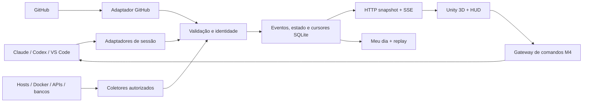

# Arquitetura proposta

Estado: arquitetura M0–M4 integrada; M5 implementada parcialmente na PR da [issue #6](https://github.com/RodReis/war-room3d/issues/6). Adaptadores de logs, rastros e segurança ainda não estão conectados.

## Fluxo

## Fronteiras

| Módulo | Entrada | Saída | Regra |
|---|---|---|---|
| Adaptador | Fonte configurada | Fato com versão, origem e cobertura | Não decide sala ou comando |
| Registro de projetos | Caminho/alias autorizado | `projectId` estável | Nome de pasta não basta |
| Normalizador/reducer | Evento validado | Estado e diagnóstico | Duplicata não gera nova ação |
| Store | Evento e cursor | Revisão transacional | Publicar após commit |
| API local | Snapshot, deltas, comandos permitidos | Contrato versionado | Loopback, autenticação e modo |
| Unity | Modelo de leitura | Cena e HUD | Não interpreta arquivos de provedores |

## M5 — observações e incidentes

`OperationsStore` mantém catálogo de fonte/ambiente/permissões, cobertura por categoria, observações redigidas, correlação por IDs exatos, regras imutáveis por versão e trilha de incidente. A API local pagina logs, rastros, rede, detecções, relatórios e incidentes. Filtros por ambiente são obrigatórios; projeto, recurso e período refinam a consulta. Mutações de incidente exigem credencial de comando e vínculo explícito do recurso ao projeto do ator.

O único produtor ligado é opt-in: sondas HTTP já cadastradas em M2 podem enviar latência/status como sinais de rede, com retenção configurada. A fonte perdida marca cobertura indisponível e não resolve incidente. Ausência de adaptador de logs/traces ou detector retorna `absent`/`no_data`; não há SIEM implícito.

Sessão, agente, projeto, recurso e ambiente mantêm IDs diferentes. Eventos de infraestrutura não inventam sessão. Presença, execução, frescor e cobertura são estados distintos. Sem fonte válida, apresentar “Sem dados”. A falha do serviço deve manter o último dado com horário e sinal de desatualização, nunca simular atividade.

## Resiliência e proteção

Leitura incremental reconcilia arquivos e hooks; cursor e estado são persistidos na mesma transação. Snapshot tem revisão; SSE entrega deltas posteriores e manda ressincronizar quando o cursor expira. Credenciais ficam fora da Unity e do Git. Comandos de M4 são auditados antes do envio e rejeitados em demo/replay. Regras detalhadas e metas propostas estão no [GDD](../GDD.md) e no [PRD](../PRD.md).
