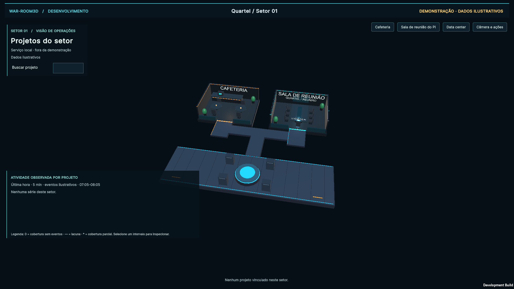
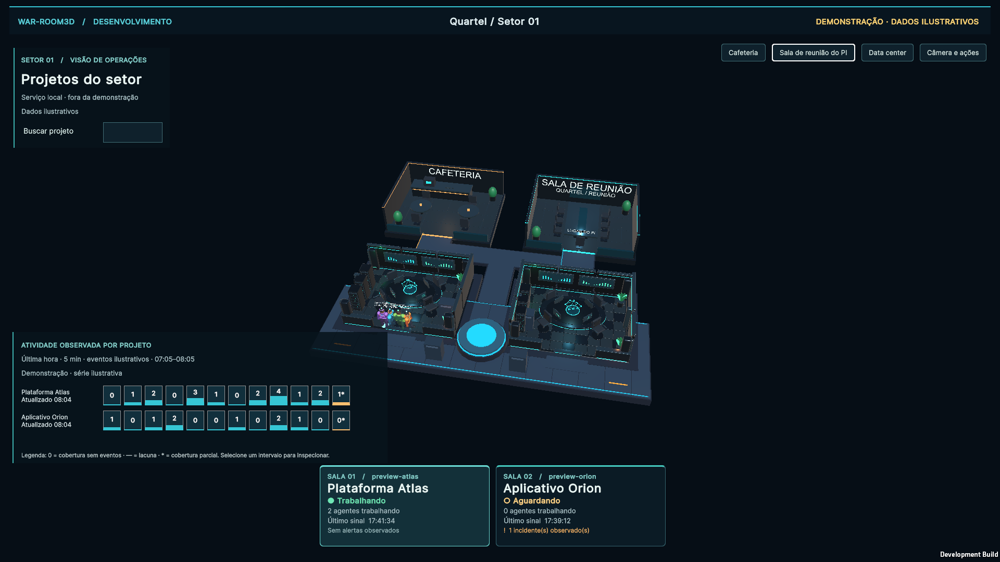
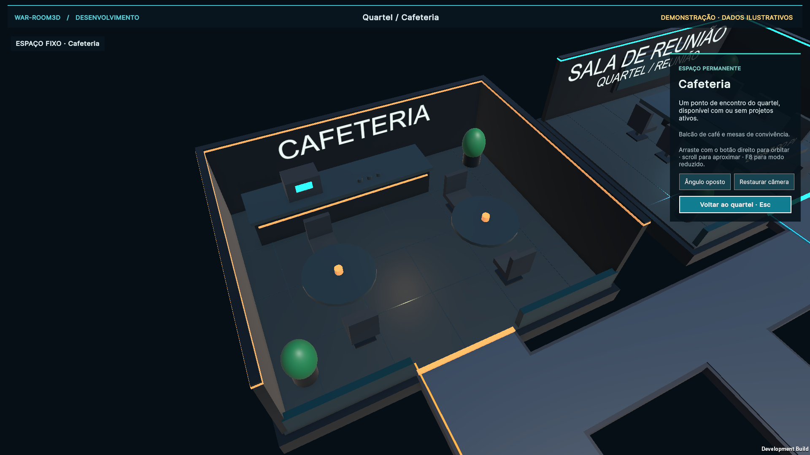
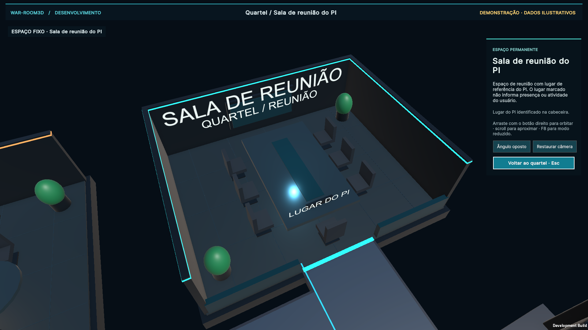

# #53 — Cafeteria e sala de reunião fixa do PI

Execução autorizada pelo PI em 26/11/2026, após o aceite com limites da #52. Base `178e800`; código dos espaços em `19eb4f2`, reparo de testes da [#64](https://github.com/RodReis/war-room3d/issues/64) em `3949bc1`. Integração remota e aceite funcional são registrados na issue.

Build final corresponde ao código `47fa7e7`, incluindo a sincronização do ensaio visual. [Manifesto](issue-53/build-manifest.json).

## Comportamento implementado

Dois prefabs autorais em `unity/Assets/WarRoom3D/Prefabs/FixedSpaces/`, com os materiais já distribuídos no projeto. A cafeteria tem balcão, máquina, xícaras, mesas e cadeiras; a reunião tem mesa, tela, cadeiras e placa **Lugar do PI**, sem personagem ou sinal de presença do usuário.

IDs `cafeteria` e `pi-meeting`, posições locais `(-7, 0, 16.5)` e `(7, 0, 16.5)`. O cadastro `FixedSpaces` é separado dos seis slots de projetos. Os espaços e a circulação central/transversal são construídos uma vez, sem depender de snapshot, projetos ou sessões. Atualização de projetos, perda de vínculo ou troca de setor não os remove nem reposiciona.

Entrada pelos botões focáveis do quartel, submit do teclado ou objeto 3D. O alvo mais próximo decide a seleção entre salas dinâmicas e espaços fixos. A visita tem descrição, órbita/zoom, ângulo oposto, restauração da câmera e retorno por botão ou Escape; o retorno recupera o foco da entrada. Atualizações de dados preservam câmera e contexto da visita. F8 reutiliza o modo reduzido existente.

## Provas executadas

| Prova | Resultado | Evidência local |
|---|---|---|
| Teste antes da implementação | `fail` esperado: `FixedSpaces`/`OpenFixedSpace` ausentes | `Logs/issue-53-red-compile.log`, compilador Roslyn do Unity com o response file dos testes |
| Contratos, Node 24 | `pass`, 19/19 | `Logs/issue-53-contracts.log` |
| Tipos do serviço, Node 24 | `pass` | `Logs/issue-53-typecheck-final.log` |
| Serviço, Node 24 | `pass`, 188/188 | `Logs/issue-53-service-final.log` |
| Unity EditMode | `pass`, 15/15 | `Logs/issue-53-editmode.xml` |
| Unity PlayMode final | `pass`, 36/36 | `Logs/issue-53-playmode-release2.xml`, 14,508 s |
| Build Windows Development | `pass`, Unity 6000.3.27f1 | `Logs/issue-53-build-capture.log`, método `BuildWindowsFixedSpaces` |
| Player 1920×1080 | `pass`, fixture local | `Logs/issue-53-proof-1920/resultado.txt` |
| Player 1440×900 | `pass`, fixture local | `Logs/issue-53-proof-1440/resultado.txt` |
| Player 1366×768 | `pass`, fixture local | `Logs/issue-53-proof-1366/resultado.txt` |

Comandos: em `contracts`, `npx --yes node@24 --test test/*.test.mjs`; em `service`, `npx --yes node@24 node_modules/typescript/bin/tsc --noEmit` e `npx --yes node@24 --test`. Unity `6000.3.27f1`, Windows x64: `Unity.exe -batchmode -projectPath <repo>/unity -runTests -testPlatform PlayMode -testResults <repo>/Logs/issue-53-playmode-release2.xml -logFile <repo>/Logs/issue-53-playmode-release2.log`. EditMode usa `-nographics -testPlatform EditMode`.

Os quatro testes `FixedSpaceTests` verificam: preservação de instância/posição com zero/seis projetos e outro setor; ausência de avatares nesses espaços; seleção física; F8; submit de teclado; visita preservada durante snapshot; Escape e foco; recarga de cena com cliente conectado. O último caso surgiu de uma falha real de ciclo de vida: `OnDisable` do transporte disparava atualização depois de destruir a arquitetura. A proteção evita atualizar setor desativado, e o cálculo de limites ignora objetos já destruídos.

## Player e capturas

Executável local em `unity/Builds/WarRoom3D-FixedSpaces/WarRoom3D.exe`; o Player da #52 foi preservado. Reprodução do ensaio: `WarRoom3D.exe -wr3d-quartel-demo -wr3d-fixed-spaces-capture <pasta-nova> -screen-fullscreen 0 -screen-width 1920 -screen-height 1080 -force-d3d11`. A captura é opt-in e só instala com a flag de demonstração. A pasta recebe oito PNGs e `resultado.txt`; encerramento com código zero indica que as verificações passaram.

Em cada resolução, o mesmo Player visitou ambos os espaços sem projetos; mostrou perfil visual, reduzido e ângulo oposto; alternou snapshots vazios/com dois projetos durante a visita; conferiu câmera e posição preservadas; retornou pelo botão com submit de teclado e foco recuperado. A prova de seis slots e outro setor é PlayMode, não uma captura de seis projetos. Escape e seleção física são provados pelo Input System nos testes; o ensaio do Player usa submit de navegação.

As imagens abaixo são capturas integrais revisadas, com dados sintéticos identificados. Os nomes e rótulos do HUD estão legíveis nas três resoluções; a placa do lugar do PI fica visível, sem ocupante. O enquadramento dos interiores mostra parte do espaço vizinho; a visita preserva a arquitetura compartilhada.

## Revisão técnica

Aplicada a skill local `code-review-and-quality`: correção/limites, legibilidade, arquitetura, segurança e desempenho. Corrigidos a seleção de alvo oculto atrás de outro espaço, o acesso físico que dependia do piso dinâmico, a atualização durante descarregamento e a sincronização da captura com o layout. IDs, slots e sinais observados permanecem separados; nenhuma dependência foi adicionada. O crescimento volumoso do diff corresponde ao YAML dos dois prefabs gerados, não a milhares de linhas de lógica. Não há revisão externa ou aceite humano implícitos nesta autorrevisão.

## Imprevistos e limites

As primeiras execuções do Unity precisaram recompilar/importar pacotes do checkout movido. O modo `-noUpm` não serviu como validação porque os assemblies de pacotes ficaram indisponíveis; o resultado final usa resolução normal de pacotes.

A validação inicial do serviço teve 18 falhas: fixtures de 06–08/11 eram comparadas ao relógio real de 26/11 e expiravam pelas políticas de 7/14 dias. A #64 fixa apenas `Date` pelo mock oficial do Node 24, mantendo timers de rede reais e os critérios de retenção de produção. O teste de migração que usa `strftime('now')` do SQLite conserva o relógio real do banco. Fonte: [Node 24 — mock timers](https://nodejs.org/docs/latest-v24.x/api/test.html#class-mocktimers).

O controle visual nativo não conseguiu conectar ao pipe local. A primeira tentativa de captura ficou sem textura e a seguinte pausou sem foco. O ensaio opt-in do Player agora ativa `Application.runInBackground`; isso não altera a configuração padrão do produto.

Esta fatia não ativa hooks, lê sessões pessoais nem acessa infraestrutura. Testes e ensaio visual usam dados sintéticos. RNF-01/02 de 600 s, matriz física de DPI e nova integração com fonte real não foram executados para este build; resultados da #52 não são transferidos. Aceite funcional do PI permanece separado da integração técnica.
