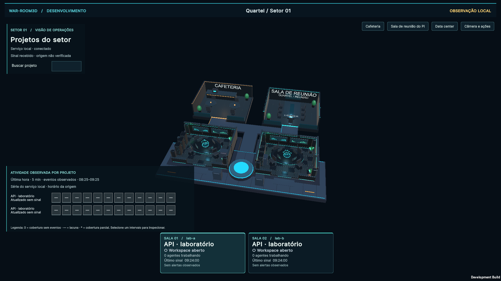

# #54 — Descoberta autorizada de workspaces no VS Code

Execução autorizada pelo PI em 26/11/2026, após #52 e #53. Código `4058605c69c4fcef70921098e294b55e34581a99`, base `1376127`. Integração/CI e aceite funcional são registrados separadamente na [issue #54](https://github.com/RodReis/war-room3d/issues/54).

## Entrega e fonte

Extensão desktop local em `integrations/vscode-workspaces`, usando a API pública `workspace.workspaceFolders` e `onDidChangeWorkspaceFolders`. A ativação reconcilia o conjunto inteiro porque a alteração da primeira pasta reinicia o Extension Host sem disparar esse evento. A configuração de usuário é opt-in, fixa a versão do VS Code e vincula cada projeto por caminho/aliases explícitos. Configuração de pasta/workspace não autoriza coleta. Publicação é recusada em workspace sem trust, remoto/virtual ou versão sem autorização.

Cada janela publica lease próprio por projeto com hashes de identidade, versão, timestamp e estado. O diretório é exclusivo da fonte, o arquivo é limitado a 4 KiB e escrito por substituição atômica. Não há leitura de arquivos de projeto, prompts, chats ou eventos de outras extensões. Arquivos adulterados, campos extras e escopos inválidos não viram presença. O coletor reinicia sem duplicar eventos, mantém os seis slots existentes e distingue perda de uma janela de fechamento explícito.

A migração 23 separa `workspace_source_bindings` dos bindings Claude/Codex. Fontes workspace não publicam sessões, agentes, recursos ou cobertura operacional. `workspace.unavailable` representa incerteza individual; o vencimento de uma janela não transforma outra janela ativa em indisponível. Heartbeats de workspace não entram no gráfico de eventos operacionais nem produzem zero de atividade demonstrada.

[Configuração, limites e remoção reversível](../../../integrations/vscode-workspaces/README.md) · [manifesto](issue-54/manifest.json).

## Provas executadas

| Prova | Resultado | Evidência |
|---|---|---|
| Teste inicial antes da implementação | `fail` esperado, módulo da fonte ausente | `Logs/issue-54-red.log` local |
| Contratos, Node 24 | `pass`, 19/19 | `Logs/issue-54-contracts-final.log` local |
| Tipos do serviço | `pass` | `Logs/issue-54-typecheck-final.log` local |
| Serviço, Node 24 | `pass`, 201/201 | `Logs/issue-54-service-final.log` local |
| Boot do entrypoint HTTP com `WR3D_WORKSPACES_CONFIG_PATH` | `pass`, presença pela API sem sessões/agentes | `workspace-runtime.test.mjs` |
| VS Code nativo: multi-root, homônimos, fontes concorrentes, perda/retomada e revogação | `pass` | [resultado sanitizado](issue-54/native-lifecycle.json) |
| VS Code nativo: fechamento normal do host | `pass`, vínculos fechados e salas removidas | [resultado sanitizado](issue-54/native-shutdown.json) |
| VS Code nativo: workspace não confiável | `pass`, trust false, nenhuma presença publicada | [resultado sanitizado](issue-54/native-untrusted.json) |
| VS Code → arquivos → store/API → Player Windows | `pass`, 1920×1080, duas salas e zero sessões/agentes/avatares | [imagem integral](issue-54/player-workspaces.png), manifesto e resultado lifecycle |

Comandos: em `contracts`, `npx --yes node@24 --test test/*.test.mjs`; em `service`, `npx --yes node@24 node_modules/typescript/bin/tsc --noEmit` e `npx --yes node@24 --test`. O teste de restrição de papel também falhou antes da correção: evento de recurso sem `projectId` era aceito para a fonte workspace (`Logs/issue-54-role-red.log`); a validação passou a consultar o papel pelo sourceId independentemente desse campo.

O ensaio nativo usa `service/scripts/issue54-vscode-lab.mjs` e o runner `integrations/vscode-workspaces/test/native.cjs` em VS Code **1.148.0**, commit instalado **661626d0e72f97806550790a98fb87116c9db825**, Windows x64. Três perfis, bancos, autorizações e workspaces descartáveis próprios; nenhum perfil habitual ou projeto pessoal foi habilitado. A API observou duas pastas locais homônimas chamadas API, criadas pelo laboratório.

No cenário lifecycle, a remoção da segunda pasta publicou fechamento só de seu vínculo. Uma sessão **sintética**, inserida separadamente no store para esse projeto, manteve a sala até seu próprio encerramento. Essa etapa prova composição de fontes, não integração Claude real. Na captura inicial do Player a sessão sintética ainda não tinha sido inserida: os contadores eram todos zero.

A perda de transporte foi induzida somente em um diretório de spool do laboratório. Após o prazo de validade, o projeto A ficou incerto e B continuou ativo; restaurar o diretório recuperou A no mesmo slot. O ensaio terminou removendo a configuração do publicador, com zero salas. A rodada shutdown deixou a publicação ativa até a desativação normal do host, que escreveu os fechamentos. Tokens, logs brutos e perfis permanecem locais em `Logs/`, ignorados pelo Git; só resultados sanitizados foram publicados.

Os cenários trusted seguem a receita oficial de testes com `--disable-workspace-trust` **exclusivamente no perfil descartável**. Isso não demonstra concessão humana de confiança. A contraprova untrusted mantém o mecanismo habilitado e verifica `workspace.isTrusted === false`, sem publicação. A extensão do produto nunca altera trust.

## Player

O cliente C# não mudou nesta fatia. Foi reutilizado o build Windows Development da #53, Unity 6000.3.27f1, runtime `9F02AAD0…E56458B5`; o ensaio usou Direct3D 11. O launcher exe é idêntico entre builds e não identifica sozinho seu conteúdo: manifesto também registra o runtime. O Player consumiu a API do laboratório enquanto o VS Code mantinha os dois workspaces abertos.

A captura mostra nomes iguais com IDs/slots distintos, status **Workspace aberto**, zero agentes trabalhando e lacunas no gráfico de atividade. O selo de observação local descreve a fonte efetivamente executada; os projetos são sintéticos e identificados como laboratório. A captura inicial não é vídeo contínuo de todas as transições, que foram conferidas na API.

## Revisão e limites

Autorrevisão nos cinco eixos da skill `code-review-and-quality`, sem achados bloqueantes remanescentes. Foram corrigidos isolamento da perda por janela, host antigo encerrando publicação nova, diretórios de spool equivalentes com separador final e validação do papel da fonte sem `projectId`. Não há dependência nova de execução. A normalização no pacote CJS da extensão é testada contra o algoritmo canônico do serviço porque os runtimes são distribuídos separadamente.

Não houve instalação permanente, coleta de projetos pessoais, VS Code Chat, Codex/Claude nativos, workspace remoto/virtual, troca real da primeira pasta para forçar restart do host, RNF de 600 s, matriz física de DPI ou nova execução EditMode/PlayMode. Esses itens não recebem `pass` por inferência. A ativação após restart é coberta pela reconciliação e pelo teste de concorrência entre hosts; a interrupção abrupta continua produzindo incerteza até novo sinal, sem presumir fechamento. Aceite funcional do PI permanece separado da integração técnica.

Limite desta versão: até 256 arquivos por fonte; registros fechados não são removidos automaticamente. Ao atingir o limite a fonte sinaliza indisponibilidade, sem descartar registros silenciosamente. A política de limpeza do spool é explícita no README e não equivale à remoção de arquivos do projeto.

Fontes oficiais consultadas via Context7: [API de workspace](https://code.visualstudio.com/api/references/vscode-api), [Workspace Trust](https://code.visualstudio.com/api/extension-guides/workspace-trust), [Extension Host](https://code.visualstudio.com/api/advanced-topics/extension-host) e [testes de extensões](https://code.visualstudio.com/api/working-with-extensions/testing-extension).
